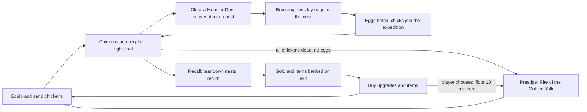
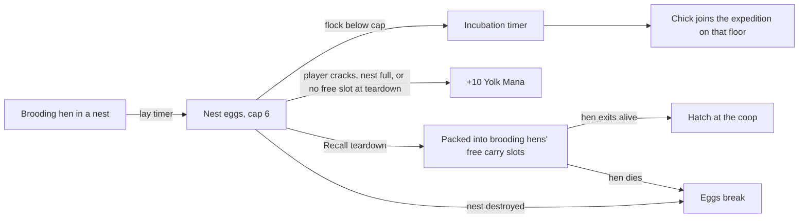
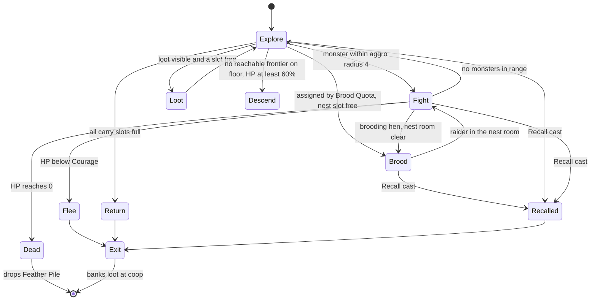

# Chicken Dungeon: Game Bible

Working title: **Chicken Dungeon**. Genre: top-down 2D idle auto dungeon crawler. Target: PC (Steam) and web, landscape, mouse-first.

Every number in this document is a starting value for tuning. Every design call made without the owner's input is listed in [Open Questions](#open-questions) with its alternative.

## Pitch and Pillars

You are a chicken-mancer, a hedge wizard whose only familiar is a single hen. She lays eggs. The eggs hatch. The flock pours into a procedurally generated dungeon under the coop, fans out on its own, pecks monsters to death, and drags treasure home. You decide when to call them back, what to spend the gold on, and what gear each chicken carries down. When the last chicken dies, the bloodline is reborn stronger.

### Pillars

1. **The flock grows itself.** One hen becomes a swarm through eggs. Growth is the core fantasy, and every system feeds or limits flock size.
2. **Hands off, choices on.** Chickens move, fight, and loot without input. The player's levers are recall timing, upgrades, gear, where to build nests, and how many hens brood.
3. **Greed versus recall.** Gold only counts once a chicken carries it out. Every minute deeper is more loot and more risk.
4. **Every chicken is someone.** Chickens have names, levels, and gear. A death costs something you can name, and it drops loot others can recover.
5. **Extinction is progress.** A full wipe triggers prestige, and the player can also choose to prestige. Losing everything converts into permanent power.

## Core Loop



1. **Send.** Chickens at the coop are equipped with stash items and auto-deploy to the deploy floor the player picks: floor 1 or any discovered Roost.
2. **Explore.** Chickens fan out, reveal the map, fight, and fill their carry slots.
3. **Nest.** Chickens destroy a Monster Den, and a hen converts the den site into a nest. Hens lay eggs only in nests.
4. **Lay.** Hens up to the **Brood Quota** settle into nests and lay eggs on a timer.
5. **Hatch.** Eggs incubate in the nest and hatch into chicks that start exploring from that floor. Breed is rolled at hatch.
6. **Defend.** Wandering monsters raid nests. Protection tiers and brooding hens keep the eggs alive.
7. **Recall.** The player recalls the whole flock, or individual chickens return when full or hurt. Brooding hens tear down their nest and pack the eggs. Chickens fight their way to the nearest exit.
8. **Bank.** Gold and items count only when a chicken exits alive.
9. **Upgrade.** Gold buys global upgrades, including nest protection, and Feed Store items. Then the loop repeats.

### Pacing targets

| Phase | Real time | Flock size | Deepest floor | Player focus |
|---|---|---|---|---|
| First session | 0 to 10 min | 1 to 4 | 1 to 3 | Learn send, nest, hatch, recall |
| First run | 30 to 60 min | 4 to 12 | 8 to 12 | First boss (Rat King, floor 10), first wipe |
| Early prestige | runs 2 to 5, 1 to 3 h each | 10 to 25 | 15 to 30 | Breeds, items, Roost routing |
| Mid game | runs 6 to 15, 3 to 8 h each | 20 to 40 | 30 to 50 | Prestige builds, boss farming |
| Late game | 15+ runs | 40+ | 50+ | Endless Hollow, leaderboard depth |

### Offline progress

When the game is closed, the dungeon is not simulated tile by tile. On return, the game grants gold equal to 50% of the average banked gold per minute over the last 10 online minutes, multiplied by minutes away, capped at 8 hours. Chickens do not die offline, so a player never returns to an unexpected prestige. Eggs lay and hatch offline at full rate up to flock cap, and nests are not raided offline.

## Chicken-mancer

The player character. The Chicken-mancer never enters the dungeon. They stand at the coop at the top of the screen and act through nests, eggs, and spells.

### Role

- Owns the coop and the stash, and chooses where nests are built.
- Casts spells using **Yolk Mana**.
- Carries permanent progress across prestiges as **Bloodline** power and Golden Yolks.

### Yolk Mana

- Mana cap starts at 50 and grows through the Yolk Reservoir upgrade.
- Passive regen: 0.1 mana per second.
- Cracking an egg grants 10 mana. The Mancer can crack any nest egg remotely. When a nest is at egg capacity, its oldest egg is cracked automatically.

### Spells

| Spell | Mana | Cooldown (s) | Effect |
|---|---|---|---|
| Recall | 0 | 30 | All chickens in the dungeon, brooding hens included, switch to Recalled and head for the nearest exit |
| Rally Cry | 10 | 45 | All chickens gain +30% ATK for 20 s |
| Feather Shield | 15 | 60 | One selected chicken takes no damage for 5 s |
| Scry | 20 | 120 | Reveals the full layout of one floor, without monsters or loot |
| Raise Bone Hen | 25 | 90 | A Feather Pile rises as a Bone Hen until the expedition ends. The Bone Hen carries the pile's loot home |

Spells are cast manually. The prestige node Familiar Instinct lets the player set auto-cast rules, for example "cast Rally Cry when 3+ chickens are in combat."

### Egg flow



## Chickens

Chickens are the only units in the dungeon. Each has a generated name (Henrietta, Clucksworth, Admiral Pecks), a breed, a level, four gear slots, and a state.

### Base stats

| Stat | Meaning |
|---|---|
| HP | Damage taken before death. Death is permanent |
| ATK | Damage per peck. Base attack interval is 1.0 s for all breeds |
| DEF | Damage reduction, see combat formula |
| Speed | Movement in tiles per second |
| Carry | Slots for items, chests' items, gems, and Golden Eggs. Gold does not use slots |
| Courage | HP percent below which the chicken flees. Default 30% |
| Lay interval | Seconds between eggs while brooding in a nest |

### Breeds

| Breed | Role | HP | ATK | DEF | Speed | Carry | Lay interval (s) | Special | Unlock |
|---|---|---|---|---|---|---|---|---|---|
| Rhode Island Red | Balanced | 30 | 5 | 2 | 2.0 | 3 | 120 | None | Start |
| Leghorn | Scout | 22 | 4 | 1 | 3.0 | 2 | 90 | Vision +2. Prefers stairs down | Reach floor 5 |
| Brahma | Tank | 55 | 4 | 5 | 1.5 | 3 | 150 | Monsters within 3 tiles target it first | Reach floor 10 |
| Bantam | Looter | 15 | 3 | 0 | 3.2 | 5 | 80 | Picks up loot from 2 tiles away | Reach floor 15 |
| Silkie | Healer | 20 | 2 | 1 | 2.0 | 2 | 100 | Heals allies within 2 tiles for 2 HP/s | Prestige: 5 GY |
| Ayam Cemani | Assassin | 25 | 9 | 1 | 2.5 | 2 | 140 | 25% crit for 2.5x. Unseen by monsters in unlit tiles | Prestige: 15 GY |
| Rooster | Brawler | 45 | 10 | 3 | 2.2 | 2 | none (does not lay) | Allies within 3 tiles gain +15% ATK | Reach floor 20 |
| Bone Hen | Undead | 18 | 6 | 0 | 2.0 | 1 | none (does not lay) | Only from Raise Bone Hen or the Bone Hens node. Crumbles on exit | Spell or prestige |

### Hatching

- Eggs incubate in the nest where they were laid. Eggs carried home in a teardown incubate at the coop. Base incubation time: 60 s.
- Breed roll for each egg: 70% same breed as the mother, 25% random unlocked breed, 5% mutation. A mutation rolls a random unlocked breed with a +10% bonus to every stat for that chicken.
- **Deep-born.** A chick from an egg laid on floor `d` starts at level `1 + floor(d / 5)`, wherever the egg hatches.
- A Golden Egg (treasure) hatches at the coop as soon as it is banked. It always hatches a breed with unlock floor 15 or higher, or a prestige breed if unlocked.
- Flock cap starts at 4 living chickens, counting both coop and dungeon. Eggs pause incubation while the flock is at cap.

### Nests

Hens lay eggs only in nests inside the dungeon. A nest is a temporary camp. Chickens build it on a cleared Monster Den, defend it during the expedition, and tear it down when they leave.

**Converting dens.** When chickens destroy a Monster Den, it leaves a **Den Site**. If fewer than 5 nests stand and the Brood Quota has an unfilled spot, the nearest hen walks to the closest Den Site and converts it into a nest in 20 s. Conversion is free. Every floor has at least one Monster Den, so the flock can always nest on the floor it is exploring.

**Tearing down.** On Recall, every brooding hen stops for 5 s to tear down camp. Each egg in the nest goes into a free carry slot of one of that nest's brooding hens. Eggs with no free slot are cracked into Yolk Mana. Packed eggs hatch at the coop when the hen exits alive and break if she dies. The torn-down nest leaves a Den Site that can be converted again next expedition. A per-chicken recall tears down the nest only when it takes the nest's last brooding hen.

**Brooding.** The Brood Quota slider sets how many hens brood. Brooding hens path to the nearest nest with a free brood slot (2 per nest), lay at their lay interval, and fight only monsters inside the nest room. Roosters and Bone Hens cannot brood. Each nest holds up to 6 eggs.

**Raids.** When a wandering monster spawns within 12 tiles of a nest, it has a 50% chance to target the nest. Raiders attack the nest, not the hens, until a hen attacks them. At 0 HP the nest is destroyed, every egg in it breaks, and the site reverts to an active Monster Den. Nest HP regenerates 1% per second while no monsters are in the room. If every brooding hen in a nest dies, the nest keeps standing and its eggs keep incubating.

**Protection tiers.** Tiers are global. Each level of the Nest Craft upgrade unlocks the next tier, and every nest built afterward uses it. Each tier keeps the effects of the tiers below it.

| Tier | Nest HP base | Effect | Nest Craft level |
|---|---|---|---|
| Straw | 40 | None | 0 |
| Thorn Hedge | 80 | Raiders take `3 × 1.13^(d − 1)` damage per second | 1 |
| Stone Ring | 200 | Damage to the nest −50% | 2 |
| Hidden Ward | 200 | Wanderers target the nest only if they spawn within 3 tiles | 3 |

```
nest_HP(t, d) = nest_HP_base(t) × 1.13^(d − 1)
```

**Depth tradeoff.** A deep nest lays deep-born eggs that hatch into higher-level chicks. Deeper raiders hit harder, and packed eggs face a longer fight out.

### Leveling

- Chickens earn XP equal to the floor number of each monster they help kill.
- XP to next level: `xp_needed(L) = 10 × L^1.5`, rounded up.
- Each level grants +4% HP and +4% ATK, multiplicative with upgrades. Level cap: 30.
- At level 10, the chicken gains one random trait.

| Trait | Effect |
|---|---|
| Brave | Courage threshold 15% instead of 30% |
| Greedy | +1 carry slot |
| Nimble | +15% speed |
| Stubborn | Survives the first lethal hit each expedition with 1 HP |
| Keen-eyed | Vision +2 |
| Broody | Lay interval 25% shorter while brooding |

### Combat

Combat is real-time and automatic. Each attack is resolved with:

```
damage = max(1, ATK × 10 / (10 + DEF_target))
crit_damage = damage × crit_multiplier
```

### AI behavior

All chickens share one fog-of-war map. Each chicken runs this state machine:



**Fan-out rule.** In Explore, each chicken claims a frontier tile (a known floor tile next to unknown space). It picks the frontier with the highest score:

```
score(f) = −path_distance(chicken, f) + 6 × min(distance(f, nearest tile claimed by another chicken), 6) + 10 × loot_visible_near(f)
```

The second term pushes chickens apart, so a flock of 10 spreads across a floor instead of trailing in a line.

**Join fights.** A chicken within 5 tiles of an ally in combat joins that fight, even if the monster is outside its own aggro radius.

**Flee and Return.** Flee and Return both path to the nearest exit using A* with a danger cost of +8 per tile within 2 tiles of a known monster. Fleeing chickens avoid combat. Returning chickens fight anything that blocks the path.

**Exits.** An exit is the floor 1 entrance or any discovered Roost at or above the chicken's current floor.

## Dungeon Generation and Depth Scaling

The dungeon is a stack of floors under the coop. Each run uses a new seed. Floors persist for the whole run. Explored tiles, dropped Feather Piles, and taken treasure stay as they are until prestige.

### Layout

| Floors | Biome | Generator | Room count (min to max) |
|---|---|---|---|
| 1 to 10 | Root Cellar | BSP rooms and corridors | 6 to 11 |
| 11 to 20 | Fox Burrows | BSP rooms with winding tunnels | 11 to 16 |
| 21 to 30 | Fungal Grotto | Cellular automata caves | 16 to 21 |
| 31 to 40 | Snake Pits | Caves with BSP vaults | 21 to 26 |
| 41 to 50 | Ossuary | BSP with long halls and side crypts | 26 to 30 |
| 51+ | The Hollow | Random mix of all generators, biome palette cycles every 10 floors | 30 |

**Placement rules.**

1. Stairs up go in a random room. Stairs down go in the room with the largest BFS distance from stairs up, so the flock must cross the floor.
2. Every floor whose number is divisible by 5 has a **Roost** room next to its stairs up. When any chicken enters it, the Roost becomes an exit and a deploy point for the rest of the run.
3. Every floor whose number is divisible by 10 has a **Boss** arena in place of the stairs-down room. The stairs down open after the boss dies.
4. Special rooms, one roll per room:

| Room type | Chance per room | Contents |
|---|---|---|
| Normal | 70% | Monsters and 0 to 2 gold piles |
| Treasure Vault | 8% | 1 chest and 3 gold piles, guarded by an Elite |
| Monster Den | 8%, minimum 1 per floor | A monster spawner. Spawns 1 monster per 30 s until destroyed. Destroying it drops 5 gold piles and leaves a Den Site that hens can convert into a nest |
| Shrine | 6% | First chicken to touch it gains +20% all stats for the expedition |
| Trap Room | 8% | Spike tiles deal 10% max HP per step |

**Treasure** does not respawn. **Monsters** respawn as wanderers: each explored floor spawns one wandering monster every 45 s, up to a cap equal to the floor's room count.

### Depth scaling formulas

For floor `d` (floor 1 is `d = 1`):

```
rooms(d)             = min(30, 6 + floor(d / 2))
map_side(d)          = min(120, 40 + 2 × d)                 # square map, in tiles
monsters_per_room(d) = 1 + floor(d / 6) + random_int(-1, 1)  # min 0
monster_HP(d)        = HP_base × 1.13^(d − 1)
monster_ATK(d)       = ATK_base × 1.10^(d − 1)
monster_DEF(d)       = DEF_base + floor(d / 4)
gold_pile(d)         = round(5 × 1.16^(d − 1))
item_level(d)        = d
```

Gold per pile grows faster per floor (1.16) than monster ATK (1.10) and nearly as fast as monster HP (1.13). Deeper floors always pay more per kill, but upgrade costs eventually outrun income, which creates the wall that prestige breaks.

| Floor | Monster HP multiplier | Monster ATK multiplier | Gold per pile | Rooms |
|---|---|---|---|---|
| 1 | 1.0 | 1.0 | 5 | 6 |
| 10 | 3.0 | 2.4 | 19 | 11 |
| 20 | 10.2 | 6.1 | 84 | 16 |
| 30 | 34.6 | 15.9 | 370 | 21 |
| 50 | 399 | 106.7 | 7,201 | 30 |

## Monsters

Stats below are base values. Actual stats use the depth scaling formulas above.

| Monster | Biome | HP base | ATK base | DEF base | Speed | Gold weight | Behavior |
|---|---|---|---|---|---|---|---|
| Cellar Rat | Root Cellar | 8 | 2 | 0 | 2.0 | 1 | Spawns in packs of 3. As fast as a Rhode Island Red, so a fleeing hen can escape |
| Cellar Spider | Root Cellar | 12 | 2 | 1 | 1.8 | 1 | Bite slows target 40% for 3 s |
| Weasel | Fox Burrows | 14 | 3 | 1 | 3.4 | 2 | Steals one carried item, or one egg from a nest, and flees. Killing it drops what it stole |
| Fox | Fox Burrows | 22 | 4 | 2 | 2.8 | 3 | Targets the lowest-HP chicken in range |
| Fungal Mite | Fungal Grotto | 10 | 2 | 0 | 2.0 | 1 | Explodes on death, 3 tile poison cloud for 4 s |
| Sporeback Toad | Fungal Grotto | 35 | 3 | 4 | 1.2 | 3 | Tongue pulls a chicken from 4 tiles away |
| Pit Snake | Snake Pits | 28 | 5 | 2 | 2.0 | 3 | Swallows a chicken whole. The chicken survives if the snake dies within 10 s |
| Cave Owl | Snake Pits | 20 | 7 | 1 | 4.0 | 4 | Dives from unlit tiles. Retreats after each hit |
| Bone Weasel | Ossuary | 26 | 5 | 3 | 3.4 | 3 | Steals like Weasel and reassembles once after death |
| Grave Fox | Ossuary | 40 | 6 | 3 | 2.8 | 5 | Howl calls all Grave Foxes on the floor |
| Mimic Coop | Any, floor 8+ | 50 | 6 | 4 | 0 | 10 | Disguised as a chest. Always drops an item |

**Elites.** Each spawned monster has a 5% chance to be Elite: 3x HP, 1.5x ATK, a gold outline, and a guaranteed item drop.

**Monster gold drop:** `monster_gold(d) = gold_weight × round(1.16^(d − 1))`, added to the killing chicken's pouch.

### Bosses

Bosses use the depth formulas, then multiply HP by 12 and ATK by 2.5.

| Boss | Floor | HP base | ATK base | DEF base | Mechanic | First-kill reward |
|---|---|---|---|---|---|---|
| Rat King | 10 | 10 | 3 | 1 | Summons 4 Cellar Rats every 15 s | Unlocks Brahma early if not unlocked, 1 Rare item |
| Old Red | 20 | 24 | 5 | 2 | Charges in a line, 2x damage on hit | 1 Epic item |
| Mother Mycelia | 30 | 40 | 4 | 5 | Spore rings expand every 8 s, poison 3% HP/s | 1 Epic item, 1 Golden Egg |
| The Coiled One | 40 | 45 | 6 | 4 | Swallows up to 3 chickens at once | 1 Legendary item |
| The Colonel | 50 | 60 | 8 | 5 | Fries chickens below 25% HP instantly | 1 Legendary item, 1 Golden Egg |

Bosses in The Hollow (floor 60, 70, and so on) are earlier bosses with the depth scaling of their new floor and one extra mechanic from another boss.

## Treasure, Gold, and Items

### Treasure types

| Treasure | Uses a slot | Contents | Spawn |
|---|---|---|---|
| Gold pile | No | `gold_pile(d)` gold into the pouch | 0 to 2 per Normal room |
| Gem | Yes | Worth `10 × gold_pile(d)` gold when banked | 3% chance per gold pile to be a gem instead |
| Chest | Opened on the spot | `5 × gold_pile(d)` gold into the pouch, plus 1 item into a slot | 1 per Treasure Vault, 4% per Normal room |
| Golden Egg | Yes | Hatches a rare breed at the coop when banked | 0.5% per chest, boss rewards |
| Feather Pile | Yes, per item | Everything a dead chicken carried, gold and items | Wherever a chicken died |

**Gold pouch.** Gold goes into an uncapped per-chicken pouch. It is banked only when the chicken exits alive. On death, the pouch drops in the Feather Pile, and any chicken can pick it up. An uncapped pouch makes recall timing the main risk decision.

**Slots full.** If a chicken finds an item with no free slot, it leaves the item and marks it on the map. Bantams and Greedy chickens path to marked items first.

### Gear slots

Each chicken has four slots: **Head**, **Body**, **Talon** (weapon), **Trinket**. Items are equipped only at the coop, before deploy. Items found in the dungeon go into carry slots and must be banked before anyone can wear them. Gear stays on a chicken across expeditions until the player moves it. A dead chicken's gear drops in its Feather Pile.

### Rarity

| Rarity | Drop weight (%) | Stat multiplier | Affixes | Price multiplier |
|---|---|---|---|---|
| Common | 60 | 1.0 | 0 | 1 |
| Uncommon | 25 | 1.3 | 1 | 3 |
| Rare | 10 | 1.7 | 1 | 9 |
| Epic | 4 | 2.3 | 2 | 27 |
| Legendary | 1 | 3.2 | 3 | 81 |

Item stat formula:

```
item_stat = base_stat × rarity_multiplier × 1.08^(item_level − 1)
```

Monster item drop chance: `3% + 0.1% × d`, capped at 10%.

### Item list

| Item | Slot | Base stat | Special |
|---|---|---|---|
| Thimble Helm | Head | +3 DEF | None |
| Acorn Cap | Head | +8 HP | +1 vision |
| Bottlecap Shield | Body | +4 DEF | Blocks 1 hit every 10 s |
| Sock Cloak | Body | +10 HP | Monsters notice the wearer 1 tile later |
| Sewing Needle | Talon | +3 ATK | +10% crit chance |
| Toothpick Spear | Talon | +2 ATK | Hits 2 tiles in a line |
| Matchstick Torch | Talon | +2 ATK | Lights 3 tiles, sets target on fire for 2 ATK/s for 3 s |
| Wishbone | Trinket | +5 HP | Survives one lethal hit per expedition, then breaks |
| Tiny Satchel | Trinket | +2 carry slots | None |
| Bell Collar | Trinket | +2 HP | Allies within 3 tiles gain +10% ATK |
| Lucky Corn | Trinket | +2 HP | +15% gold found by this chicken |

### Affixes

| Affix | Effect per affix |
|---|---|
| of the Fox | +10% speed |
| of the Ox | +15% HP |
| of the Hawk | +10% ATK |
| of the Owl | +1 vision |
| of the Magpie | +10% gold found |
| of the Phoenix | Heals 5% max HP per kill |

### Feed Store

Gold can also buy items. The Feed Store sells 3 items at a time, Common to Rare only, and restocks every 10 minutes. Store item level equals the deepest Roost discovered this run, or 1 if none.

```
store_price = 25 × price_multiplier × 1.16^(item_level − 1)
salvage_value = 0.2 × store_price
```

Stash capacity is 30 items. Salvaging an item converts it to gold at `salvage_value`.

## Upgrades and Economy

Upgrades are global. They apply to every chicken, current and future, until prestige resets them.

### Cost formula

```
upgrade_cost(L) = base_cost × growth^L      # L = current level, starting at 0
```

### Upgrade table

| Upgrade | Effect per level | Base cost | Growth | Max level |
|---|---|---|---|---|
| Sharper Beaks | ATK x1.10 | 10 | 1.15 | uncapped |
| Thicker Feathers | HP x1.10 | 10 | 1.15 | uncapped |
| Hardened Comb | DEF +1 | 25 | 1.20 | 50 |
| Quick Feet | Speed +3% | 40 | 1.25 | 25 |
| Bigger Crop | Carry +1 | 100 | 1.60 | 6 |
| Brave Heart | Courage threshold −2 points, floor 10% | 60 | 1.30 | 10 |
| Lantern Oil | Vision +1 tile, base 5 | 80 | 1.50 | 5 |
| Coop Expansion | Flock cap +2 | 50 | 1.45 | 20 |
| Warm Straw | Incubation time x0.92 | 30 | 1.25 | 15 |
| Laying Mash | Lay interval x0.94 | 30 | 1.25 | 15 |
| Bigger Nests | +1 brood slot per nest | 200 | 2.50 | 3 |
| Nest Craft | Unlocks the next nest protection tier | 100 | 10 | 3 |
| Yolk Reservoir | Mana cap +10 | 40 | 1.30 | 20 |

### Why the numbers work this way

- Monster HP grows 1.13x per floor. Sharper Beaks grows ATK 1.10x per level, so the flock needs about 1.28 ATK levels per floor to keep pace (`ln 1.13 / ln 1.10`).
- The cost of 1.28 levels grows `1.15^1.28 ≈ 1.196x` per floor. Gold grows 1.16x per floor. Income falls about 3% further behind per floor, which produces a soft wall around floors 20 to 30 on a first run.
- Prestige Bloodline multipliers and breed unlocks push the wall deeper each run.

### Sources and sinks

| Flow | Type | Formula or amount |
|---|---|---|
| Gold piles | Source | `gold_pile(d)` |
| Monster kills | Source | `gold_weight × round(1.16^(d − 1))` |
| Chests | Source | `5 × gold_pile(d)` |
| Gems | Source | `10 × gold_pile(d)` |
| Salvage | Source | `0.2 × store_price` |
| Upgrades | Sink | `base_cost × growth^L` |
| Feed Store | Sink | `25 × price_multiplier × 1.16^(item_level − 1)` |

Healing is free. Chickens resting in the coop regain 2% max HP per second.

## Recall Mechanic

Recall is the player's main decision. It turns loot in the dungeon into banked progress, at the cost of a dangerous trip out.

### Rules

1. Casting **Recall** (0 mana, 30 s cooldown) sets every chicken in the dungeon to Recalled, brooding hens included. The roster also has a per-chicken recall button with no cooldown.
2. Brooding hens tear down camp first: 5 s in place, eggs packed into their free carry slots, overflow cracked into Yolk Mana. Packed eggs bank at the coop only if their carrier exits alive.
3. A Recalled chicken paths to the nearest exit: the closest discovered Roost at or above its floor, or the floor 1 entrance.
4. Recalled chickens move 20% faster, ignore loot unless it is within 1 tile, and fight only monsters that block their path or attack them.
5. **The dungeon stirs.** When Recall is cast, every floor on any chicken's route respawns 25% of the monsters killed on it this expedition. These monsters are Agitated: +20% ATK and double aggro radius. This is the "fight your way out" pressure.
6. A chicken that reaches an exit teleports to the coop and banks its pouch and carried items.
7. Chickens below Courage threshold still flee. Recalled status does not override self-preservation.

### Expected exit time

The HUD shows an ETA for each Recalled chicken:

```
exit_eta = path_length_to_exit / (speed × 1.2) + 4 × floors_to_climb
```

The second term is a flat 4 s per floor for stair transitions.

### Auto-return

Without Recall, a chicken returns on its own when all carry slots are full (Return state) or its HP is below Courage (Flee state). The Dinner Bell prestige node adds auto-recall rules for idle play.

### Recall timing tradeoff

| Recall timing | Gold banked | Death risk | Best when |
|---|---|---|---|
| Early, light pouches | Low | Low | Flock is small, a wipe would trigger prestige too soon |
| On boss kill | High | Medium | A Roost is one floor above |
| Late, heavy pouches | Highest | High | Bloodline is strong, or the player wants to prestige |

## Prestige

### Triggers

Prestige happens in one of two ways. The Golden Yolk formula is the same for both.

1. **Extinction.** Automatic when there are zero living chickens and zero eggs in nests or incubating at the coop. Bone Hens do not count as living. A nest whose brooding hens all died can still save a run, because its eggs keep hatching.
2. **Voluntary.** The player can start the Rite from the Ancestral Coop panel at any time once a chicken has reached floor 10 this run. Living chickens and eggs are lost, as in extinction.

### The Rite of the Golden Yolk

When prestige triggers, the Chicken-mancer performs the Rite. The screen shows the Roll of Feathers (every chicken that died this run, with name, level, and killer), then the Golden Yolks earned.

### Prestige currency formula

```
golden_yolks = floor( 2 × (D_max / 5)^1.5 + log10(1 + G_total) + 3 × B )
```

- `D_max`: deepest floor any chicken reached this run.
- `G_total`: total gold banked this run.
- `B`: number of distinct bosses killed this run.

| D_max | G_total | Bosses | Golden Yolks |
|---|---|---|---|
| 10 | 5,000 | 1 | 12 |
| 20 | 100,000 | 2 | 27 |
| 30 | 2,000,000 | 3 | 44 |
| 50 | 500,000,000 | 5 | 86 |

### Bloodline multiplier

Every Golden Yolk ever earned adds to **Bloodline**, which is never spent:

```
bloodline_multiplier = 1 + 0.02 × lifetime_golden_yolks
```

The multiplier applies to chicken HP, ATK, and all gold income. Golden Yolks are also a spendable currency in the Ancestral Coop. Spending does not reduce Bloodline.

### What resets and what carries over

| Item | On prestige |
|---|---|
| Gold, upgrades, Feed Store stock | Reset to 0 |
| Stash items | Lost, except Heirloom slots |
| Flock and eggs | Reset to 1 Rhode Island Red and 1 egg incubating at the coop, plus Second Hen ranks |
| Dungeon and nests | New seed, all floors regenerated, all nests and Den Sites lost |
| Golden Yolks, Bloodline | Kept |
| Breed unlocks from floor milestones | Kept |
| Ancestral Coop nodes | Kept |
| Bestiary and Roll of Feathers | Kept |

### Ancestral Coop

Node cost formula:

```
node_cost(rank) = base_cost × 2^rank      # rank = current rank, starting at 0
```

| Node | Effect per rank | Base cost (GY) | Max rank |
|---|---|---|---|
| Second Hen | Start each run with +1 Rhode Island Red | 3 | 3 |
| Inheritance | Start each run with `100 × 4^rank` gold | 2 | 5 |
| Deep Roost | Start each run with the Roost on floor `5 × rank` discovered | 5 | 4 |
| Ancestral Nest | Start each run with one Nest Craft level already bought | 4 | 3 |
| Silkie Bloodline | Unlocks Silkie | 5 | 1 |
| Cemani Bloodline | Unlocks Ayam Cemani | 15 | 1 |
| Bone Hens | Dying chickens have a `20% × rank` chance to rise as a Bone Hen | 6 | 3 |
| Dinner Bell | Unlocks auto-recall rules: by timer, by total pouch gold, or by flock HP | 4 | 1 |
| Familiar Instinct | Unlocks spell auto-cast rules | 8 | 1 |
| Heirloom | Keep 1 stash item through prestige per rank | 6 | 3 |
| Long Night | Offline cap +4 hours per rank | 3 | 3 |

## UI and HUD

The screen has one main view, the dungeon map, with panels around it. Internal resolution 480x270, integer-scaled.

```
+--------------------------------------------------------------------------+
| Gold 1,240 | Golden Yolks 12 | Flock 7/10 | Eggs 2 | Mana 34/60 | Floor B7 |
+-----------------+--------------------------------------+-----------------+
| FLOCK ROSTER    |                                      | COOP            |
| Henrietta  ██▒  |                                      |  [Upgrades]     |
|  Explore  B7    |        top-down dungeon view         |  [Feed Store]   |
| Clucksworth ██  |        fog of war, chickens,         |  [Stash/Equip]  |
|  Return   B6    |        monsters, loot sparkles       |  [Nests]        |
| Adm. Pecks █▒▒  |                                      |  [Ancestral]    |
|  Flee     B7    |                          [minimap]   |                 |
+-----------------+--------------------------------------+-----------------+
| [B1][B2]...[B7] floor tabs  | Brood Quota [==1==] | Spells | [ RECALL ] |
+--------------------------------------------------------------------------+
| log: Henrietta found a Rare Thimble Helm on B7.                          |
+--------------------------------------------------------------------------+
```

### Elements

1. **Top bar.** Gold, Golden Yolks, flock count over cap, eggs, mana, current floor.
2. **Flock roster (left).** One row per chicken: name, HP bar, state icon, floor. Click a row to follow that chicken with the camera. A per-row recall button appears on hover.
3. **Dungeon view (center).** Camera free-pans or follows a chicken. Floor tabs switch the viewed floor. Unknown tiles are black. Explored tiles out of vision are dimmed. Nests show an HP bar and egg count. Den Sites show a nest-ready marker.
4. **Coop panel (right).** Upgrades, Feed Store, Stash and Equip (drag items onto chicken portraits), Nests (each nest's floor, HP, eggs, and brood slots, with a crack button), Ancestral Coop (node shop and the voluntary prestige button).
5. **Action bar (bottom).** Brood Quota slider, spell buttons with cooldown rings, and the Recall button. Recall requires a 0.5 s hold to prevent misclicks.
6. **Event log.** Loot finds, deaths, nest conversions, raids, and teardowns, boss kills, level-ups. Rare and better loot lines use rarity color. A nest under attack flashes on the map and pings the log.
7. **Offline report.** On return: gold earned, eggs laid, eggs hatched, minutes simulated.
8. **Roll of Feathers.** A memorial screen listing dead chickens by run.

### State icons

| State | Icon above chicken |
|---|---|
| Explore | None |
| Fight | Crossed beaks |
| Loot | Coin |
| Return | Full sack |
| Flee | Sweat drop |
| Recalled | Coop arrow |
| Brood | Small nest |

## Art and Audio Direction

### Art

- **Style.** Pixel art, top-down with a slight three-quarter tilt. 16x16 px tiles and 16x16 px chickens. Monsters 16x16 to 32x32. Bosses 48x48 to 64x64.
- **Readability.** Each chicken wears a colored bandana chosen from 12 distinct hues, so individuals are trackable at a glance. Loot sparkles every 2 s. State icons sit 4 px above the head.
- **Tone.** Cozy coop above, eerie dungeon below. The coop uses warm straw yellows and sunset oranges. Each biome uses its own cool palette and gets warmer only where light sources exist.

| Biome | Palette anchors | Light sources |
|---|---|---|
| Root Cellar | Brown, root beige, lantern amber | Hanging lanterns |
| Fox Burrows | Rust, moss green | Glowworms |
| Fungal Grotto | Teal, mushroom violet | Bioluminescent caps |
| Snake Pits | Olive, bone white | Lava cracks |
| Ossuary | Grey, candle gold | Candles |
| The Hollow | Cycles all of the above | All of the above |

- **Animation frames per chicken.** Idle 2, walk 4, peck 3, hurt 1, death 4 (a feather burst). Dead chickens leave a small feather pile sprite.

### Audio

- **Music.** Coop theme: acoustic folk with banjo and whistle. Dungeon: chiptune layered over low strings. Music adds intensity layers as more chickens enter combat, at 0, 3, and 8 chickens in combat.
- **Chickens.** Every chicken has a cluck pitch-shifted by its ID, so a flock sounds like a crowd. Pecks are short wooden ticks.
- **Key cues.** Recall plays a rooster crow. Egg laid: soft pop. Hatch: shell crack and peep. Nest under attack: alarm squawk. Death: a single feather-whoosh and a muted cluck. Rare-or-better loot: a rising arpeggio. Prestige Rite: choir swell and a golden egg chime.

## Open Questions

Each row is a design call made without the owner's input. The right column is the main alternative.

| ID | Decision made | Alternative |
|---|---|---|
| OQ1 | Working title "Chicken Dungeon" | A punnier title, such as "Cluckmancer" |
| OQ2 | Target PC (Steam) and web, landscape | Mobile-first portrait |
| OQ4 | Flock cap counts coop and dungeon chickens together | Separate caps for coop and expedition |
| OQ5 | Chickens never die offline, offline gold is 50% of recent rate | Full offline simulation, including deaths |
| OQ6 | Yolk Mana from cracked eggs powers spells | No spells, the Mancer only recalls and buys |
| OQ7 | Five spells: Recall, Rally Cry, Feather Shield, Scry, Raise Bone Hen | A smaller set, or a spell tree |
| OQ8 | Eight breeds including Rooster and Bone Hen | Single breed with stat variation only |
| OQ9 | Breed roll: 70% mother, 25% random, 5% mutation | Player chooses breed at hatch |
| OQ10 | Chickens level individually to 30 and gain one trait at level 10 | No individual progression |
| OQ11 | Fan-out uses frontier claims with a spacing bonus | Player assigns chickens to floors or zones |
| OQ12 | Floors persist for the whole run, treasure does not respawn | Floors regenerate each expedition |
| OQ13 | Six biomes, with endless Hollow after floor 50 | Hard cap at floor 50 |
| OQ14 | Roosts every 5 floors act as exits and deploy points | Every expedition starts at floor 1 |
| OQ15 | Bosses every 10 floors gate the stairs down | Bosses are optional side rooms |
| OQ16 | Depth scaling: HP 1.13, ATK 1.10, gold 1.16 per floor | Linear scaling with tier jumps per biome |
| OQ17 | Combat formula `ATK × 10 / (10 + DEF)` with 1.0 s attack interval | Breed-specific attack speeds |
| OQ19 | Items are equipped only at the coop, not in the dungeon | Chickens auto-equip upgrades they find |
| OQ20 | Gold also buys items at a Feed Store with a 10 minute restock | Items come only from the dungeon |
| OQ21 | Five rarities, 60/25/10/4/1 drop weights | Three rarities |
| OQ22 | Upgrades are global, not per chicken | Per-chicken upgrades paid with gold |
| OQ24 | Recall has a 30 s cooldown, single-chicken recall has none | No cooldown at all |
| OQ26 | Golden Yolk formula weights depth, gold (log), and bosses | Depth only |
| OQ27 | Bloodline gives +2% per lifetime Golden Yolk to HP, ATK, and gold | Unspent yolks give the bonus, which rewards hoarding |
| OQ28 | Ancestral Coop is a flat list of 11 nodes | A branching tree with exclusive paths |
| OQ29 | Internal resolution 480x270, 16 px tiles | 320x180 with 8 px tiles |
| OQ30 | Music adds intensity layers by number of chickens in combat | Fixed track per biome |
| OQ31 | Eggs hatch in the nest during the expedition, and chicks join on that floor | Eggs never hatch in the dungeon, all are carried home |
| OQ33 | Protection tiers are a global Nest Craft upgrade, because nests are torn down every Recall | Per-nest tiers that persist on the Den Site |
| OQ34 | Wanderers raid nests within 12 tiles at 50% chance, Weasels steal eggs | Nests are attacked only during Recall |
| OQ35 | Brood Quota slider, 2 brood slots per nest, Roosters and Bone Hens cannot brood | Every hen broods when a nest has a free slot |
| OQ37 | Deep-born chicks start at level `1 + floor(d / 5)` | No bonus for deep nests |
| OQ38 | Voluntary prestige unlocks once floor 10 is reached, same Golden Yolk formula as extinction | Available from the start, or extinction pays a yolk bonus |
| OQ39 | Each run starts with 1 hen and 1 egg incubating at the coop | Each run starts with a single hen and no egg |
| OQ40 | Eggs in nests or at the coop block extinction prestige | Extinction triggers when the last chicken dies, even with eggs left |
| OQ41 | Den conversion is automatic and free, takes 20 s, max 5 nests standing | The player picks which dens to convert, or conversion costs gold |
| OQ42 | Teardown takes 5 s. Eggs fill brooding hens' free slots, overflow becomes Yolk Mana, packed eggs break if the carrier dies | Overflow eggs are left behind, or packed eggs drop in the Feather Pile |
| OQ43 | A torn-down nest leaves a reusable Den Site. A nest destroyed by raiders reverts to an active Monster Den | Every site reverts to an active Den on Recall |
| OQ44 | Every floor has at least one Monster Den | Dens stay at 8% per room with no minimum |
| OQ45 | A Monster Den has 20 base HP and 2 DEF, and keeps at most 3 of its spawn alive | Unlimited spawns, or dens with no HP that fall to any attack |
| OQ46 | Wanderers appear on every visited floor every 45 s while it holds fewer monsters than rooms, out of sight and at least 8 tiles from any chicken | The cap counts only wanderers, or only floors with chickens get wanderers |
| OQ47 | Den spawns roll for raids the same as wanderers | Only wanderers raid |
| OQ48 | Monsters and dens act only on floors that have chickens, so an unattended nest on an empty floor is never raided | Nests are raided on empty floors too |
| OQ49 | Lowering the Brood Quota sends surplus hens exploring and leaves their nests standing | Surplus hens tear their nests down |
| OQ50 | A hen converting a Den Site abandons the build when a monster comes into view | She finishes the build first |
| OQ51 | A mutation's +10% lifts HP, ATK, DEF, and speed, not Courage, vision, or carry | It lifts every stat |
| OQ52 | Yolk Mana is capped at 50 and has no use until spells exist | Cracked eggs are simply lost until spells exist |
| OQ53 | Inheritance rank 1 starts a run with 100 gold, and each further rank multiplies it by 4 | Rank 1 already starts with 400, reading `100 × 4^rank` literally |
| OQ54 | Bloodline multiplies gold at the moment a pouch is banked. Offline gold builds on that already-boosted rate | The bonus applies to each pile as it is picked up |
| OQ55 | Dinner Bell rules: minutes since the last Send, total gold in pouches, and flock HP percent. The first rule met recalls the flock | One rule at a time, or rules that also send the flock back out |
| OQ56 | Each run's seed is derived from the previous run's seed | A fresh random seed every run |
| OQ57 | The run freezes on the Rite screen, and Golden Yolks can still be spent there | Spending waits until the next run starts |
| OQ58 | Offline gold counts toward the gold total in the Golden Yolk formula | Only gold carried home counts |

### Resolved by owner

| ID | Owner's decision |
|---|---|
| OQ3 | Hens lay eggs in the dungeon, only inside a protected nest. Details are in OQ31, OQ34, OQ35, OQ37, OQ39, and OQ40 |
| OQ32 | Chickens convert Monster Dens into nests. Details are in OQ41, OQ43, and OQ44 |
| OQ36 | On Recall, chickens tear down camp and return. Details are in OQ42 |
| OQ18 | The gold pouch is uncapped |
| OQ23 | Monsters return on Recall |
| OQ25 | Voluntary prestige exists alongside extinction. Details are in OQ38 |
