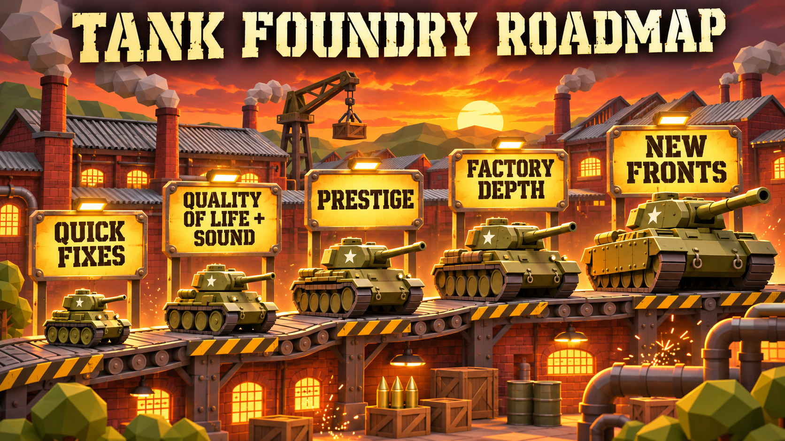

# Tank Foundry roadmap

Ordered by player value per unit of work. Each item names the gap it closes and what done looks like.

## Now: fix what players hit first

| Code | Item | Why | Done when |
|---|---|---|---|
| N1 | Late-game plateau | A simulated player stalls around wave 85 with the Maus and a front capped at 30 tanks, and nothing new arrives after ~2.5 hours. | Prestige (L1) or new scaling keeps progress measurable past wave 100. |
| N2 | Done: Bottleneck hints | Players must read five station cards to find the slow one. | The slowest station's label pulses, and the Factory panel header names it. |
| N3 | Bulk upgrades | Late-game upgrades cost one click each, and auto-upgrade only buys the cheapest. | Buy ×1 / ×10 / max toggle on station and research buttons. |
| N4 | Readable combat | Enemy tanks are all grey, and losses are hard to follow. | Enemy classes get distinct silhouettes and markings. The wave bar shows kills and losses for the current wave. |
| N5 | Done: Source page redirect | `/games/tank-foundry/` loads the raw source page, which can't run on Pages. | It redirects to `play/`. |

## Next: deepen the two halves of the game

### Factory automation
| Code | Item | Why |
|---|---|---|
| F1 | Second production line | One assembly hall is the only real choice. A second hall lets players build two models at once, for example cheap Shermans for volume and Tigers for bosses. |
| F2 | Splitters and priorities | All three shops share one steel belt. A priority dial per shop turns starved/blocked balancing into a decision instead of just upgrading. |
| F3 | Raw resources | Steel comes from nowhere. Coal and ore delivered by the train (already animated) would add a supply step and make the train meaningful. |
| F4 | Visible logistics upgrades | Warehouses and Logistics research change no visuals. More staging bays, bigger stock pallets and a wider gate should appear as they level. |

### Front line
| Code | Item | Why |
|---|---|---|
| B1 | Doctrines | Research only adds stats. Trade-off doctrines (blitz: speed and damage, less HP; entrench: HP and range, slower) give players a real choice per run. |
| B2 | Enemy variety by era | Enemies scale only by numbers. Waves past 30 should bring enemy Panthers, tank destroyers that out-range you, and air attacks that punish clustering. |
| B3 | Support units | Field repair is a flat research. A recovery vehicle, artillery battery or AA half-track built from the same factory adds composition choices. |
| B4 | Multiple fronts | One lane caps strategy. A second front with its own wave counter and rewards lets players split production. |

## Later: long-term retention

| Code | Item | Why |
|---|---|---|
| L1 | Prestige: "New offensive" | Reset the factory and waves for medals that grant permanent multipliers and unlock new starting blueprints. This is the standard fix for N1. |
| L2 | Achievements and stats | Records exist but nothing rewards milestones. Add first boss, 1,000 tanks and no-loss wave achievements, each with a small bonus. |
| L3 | Factions | Swap the Allied roster for a German or Soviet tech tree with different stat curves and visuals. The models already exist. |
| L4 | Challenge runs | Seeded modifiers such as no power upgrades or Stuart-only, with a local leaderboard. |

## Polish

| Code | Item | Why |
|---|---|---|
| P1 | Sound | The game is silent. Add machine hum, cannon fire, explosions and a wave-clear sting, with a mute toggle. |
| P2 | Day/night cycle | Window and lamp materials already glow. A slow cycle makes idle watching more interesting. |
| P3 | Battlefield detail | The front is plainer than the factory. Add trenches, ruins that crumble from artillery, scorch marks that persist for a wave, and tank tracks. |
| P4 | Camera follow | Click a tank to follow it from the assembly hall to the front. |
| P5 | Onboarding | Replace the single help modal with three step-by-step tips during the first two minutes. |

## Technical

| Code | Item | Why |
|---|---|---|
| T1 | Done: Deploy script | Publishing means copying commits to `main`, rebuilding and committing `play/` by hand. Add an `npm run deploy` script or a GitHub Action that builds on push to `main`. |
| T2 | Bundle size | The 650 KB bundle is mostly Three.js. Import only used modules or split the renderer chunk to speed up the first load on mobile. |
| T3 | Performance budget | Belt items, effects and trees are separate meshes. Instancing belt items and trees keeps 60 fps on low-end laptops at high levels. |
| T4 | Balance harness | Balance was tuned with a throwaway bot. Keep a committed `npm run balance` that prints wave progress per hour, so tuning changes can be checked. |
| T5 | Save export/import | Progress lives only in `localStorage`. A copyable save string protects against cleared storage and lets players move devices. |

## Suggested order

1. N5, T1 and N2. Small fixes that remove friction.
2. N3, N4 and P1. Quality of life plus sound, the biggest missing sense.
3. L1 with T4. Prestige needs the balance harness to tune.
4. F1 to F3. The factory-automation depth the game is named for.
5. B1 to B4, then L2 to L4 and the rest of polish.
